# Deep Reinforcement Learning for Autonomous Mobile Robot Navigation

Goal-directed navigation with static obstacle avoidance for a differential-drive robot equipped with a planar
LiDAR, learned end-to-end with Proximal Policy Optimization (PPO) in NVIDIA Isaac Lab. Each episode draws a new
arena layout (3–6 cylinders and rotated boxes) and a new goal; the policy is evaluated on layouts that were never
seen during training.

<p align="center">
  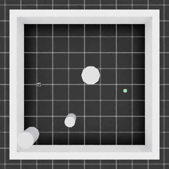
  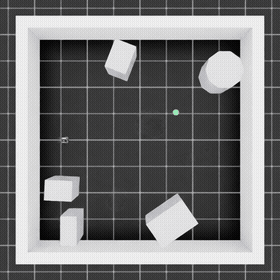
  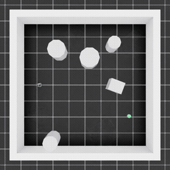
  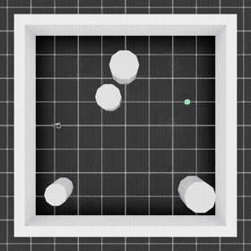
  <br/>
  <em>Deterministic policy on unseen test layouts (top-down view, 2× speed). Green sphere: goal.</em>
</p>

**Main result.** After 1,000 PPO iterations (8.2 M environment steps, 18 min on a single GPU), the
policy reaches the goal in **85.2 %** of 512 test episodes (95 % Wilson CI 81.8–88.0 %) on 454 unseen random
layouts, with 14.6 % collisions and 0.2 % timeouts.

---

## Contents

1. [Task](#1-task)
2. [Method](#2-method)
3. [Training stability](#3-training-stability)
4. [Results](#4-results)
5. [Videos](#5-videos)
6. [Reproducing the results](#6-reproducing-the-results)
7. [Repository structure](#7-repository-structure)
8. [Limitations](#8-limitations)

---

## 1. Task

| | |
|---|---|
| Robot | NVIDIA Jetbot (differential drive, wheel radius 0.0325 m, wheel base 0.1125 m) |
| Arena | 4 m × 4 m, walled (3.8 m × 3.8 m free interior) |
| Obstacles | 3–6 per episode, each a cylinder (r ∈ [0.15, 0.35] m) or a box (sides ∈ [0.2, 0.8] m, yaw ∈ [0, π)) with probability ½ |
| Start | fixed at (−1.4, 0) m, facing +x |
| Goal | random, ≥ 2.0 m from the start, ≥ 0.45 m clearance from obstacles and walls |
| Success | planar distance to the goal < 0.30 m |
| Failure | collision (closest LiDAR return < 0.25 m) or timeout (1,200 steps = 30 s) |

Every layout is checked for reachability (grid flood fill with a 0.30 m robot radius) before it is used.
Layouts are pre-generated into banks: **10,000 training layouts (seed 0)** and **2,000 test layouts (seed 1000)**.
At every reset each of the 64 parallel environments draws a new layout from its bank.

Simulation runs at 120 Hz with the policy at 40 Hz (decimation 3).

## 2. Method

### Observation (133-D)

| Dimensions | Content |
|---|---|
| 0–119 | LiDAR: 360 rays at 1° resolution, ranges clipped to [0.15, 2.0] m, min-pooled into 120 sectors of 3° |
| 120–124 | heading error to the goal (rad), repeated 5× |
| 125–129 | distance to the goal (m), repeated 5× |
| 130–132 | planar linear velocity (m/s) and yaw rate (rad/s) |

The LiDAR is an analytic, GPU-batched planar ray caster (ray–circle, ray–oriented-box via the slab method,
ray–arena interior), which gives exact ranges for a different obstacle set in every environment.

**Domain randomisation.** At every reset a Gaussian offset is drawn per observation dimension (σ = 0.2) and per
action dimension (σ = 0.05) and held for the whole episode. The heading and distance terms are repeated so that
the policy can average out their independent offsets.

### Action

Two continuous actions in [−1, 1], mapped to linear velocity v ∈ [0.1, 0.5] m/s and yaw rate
ω ∈ [−0.5, 0.5] rad/s, then converted to wheel velocities with the unicycle model. The robot cannot stop or
reverse (v ≥ 0.1 m/s).

### Reward

With d<sub>t</sub> the goal distance and r<sub>t</sub> the closest LiDAR return:

| Term | Value |
|---|---|
| progress | 10 (d<sub>t−1</sub> − d<sub>t</sub>) |
| potential | 0.1 (d<sub>t−1</sub> − d<sub>t</sub>) / (1/60) |
| proximity | −exp(−r<sub>t</sub>) if r<sub>t</sub> < 0.40 m |
| goal | +30, plus a time bonus 0.02 × (remaining steps) |
| collision | −30 (episode ends) |
| timeout | −30 (episode ends) |

Rewards are scaled by 0.1 for learning; all reported returns are unscaled.

### Policy and PPO

Actor-critic MLP with a shared trunk [256, 128, 64] (ELU) and a state-independent learned log-std, trained with
[RL-Games](https://github.com/Denys88/rl_games) PPO:

| Hyper-parameter | Value |
|---|---|
| parallel environments | 64 |
| rollout length | 128 steps (8,192 transitions / iteration) |
| minibatch size / epochs | 4,096 / 4 |
| discount γ / GAE λ | 0.995 / 0.95 |
| learning rate | 3 × 10<sup>−4</sup>, linear decay to 10<sup>−6</sup> over training |
| clip ε | 0.2 (policy and value) |
| entropy coefficient | 0 |
| critic coefficient | 2 |
| action bound loss | 0.01 (soft bound at \|μ\| = 1.1) |
| gradient norm clip | 1.0 |
| normalisation | observations (running mean/std), values, advantages |
| iterations / seed | 1,000 / 42 |

### Curriculum

During the first 300 iterations an environment receives a fixed reference scene (four cylinders of radius 0.3 m at
(±0.75, ±0.75) m, goal at (1.4, −1.4) m) with probability 1 − t / 300, and a random layout otherwise. From
iteration 300 on, every episode uses a random layout.

## 3. Training stability

A preliminary run with the same task but an adaptive learning-rate schedule (KL target 0.008), γ = 0.99, a weak
action bound loss (10<sup>−4</sup>), a stepped proximity penalty (−1/−3/−5 per step below 0.40/0.35/0.30 m) and
no curriculum peaked at **≈ 49 % success (iterations 201–300) and then degraded to 7–18 %**, with timeouts rising to
34 %. The training logs point to two causes:

* **Learning-rate drift.** The adaptive scheduler multiplies the learning rate by 1.5 whenever the KL divergence
  falls below half the target. It stayed at 2–4.4 × 10<sup>−3</sup>, i.e. 7–15× the nominal 3 × 10<sup>−4</sup>,
  for the whole run.
* **Action saturation.** The mean action drifted outside [−1, 1] (bound loss ≈ 3 at iteration 400 vs. ≈ 10<sup>−4</sup>
  at the start); the clipped commands produced full-speed or full-turn behaviour, e.g. circling until timeout.

In addition, with γ = 0.99 (effective horizon ≈ 100 steps) the terminal goal/timeout rewards of 1,200-step
episodes are nearly invisible to the critic, and the stepped proximity penalty dominates the return in cluttered
layouts.

The configuration in Section 2 addresses all five points (linear decay, bound loss 0.01, γ = 0.995, exponential
proximity penalty, curriculum). The changes were applied together, so their individual contributions are **not**
separated by this experiment.

<p align="center">
  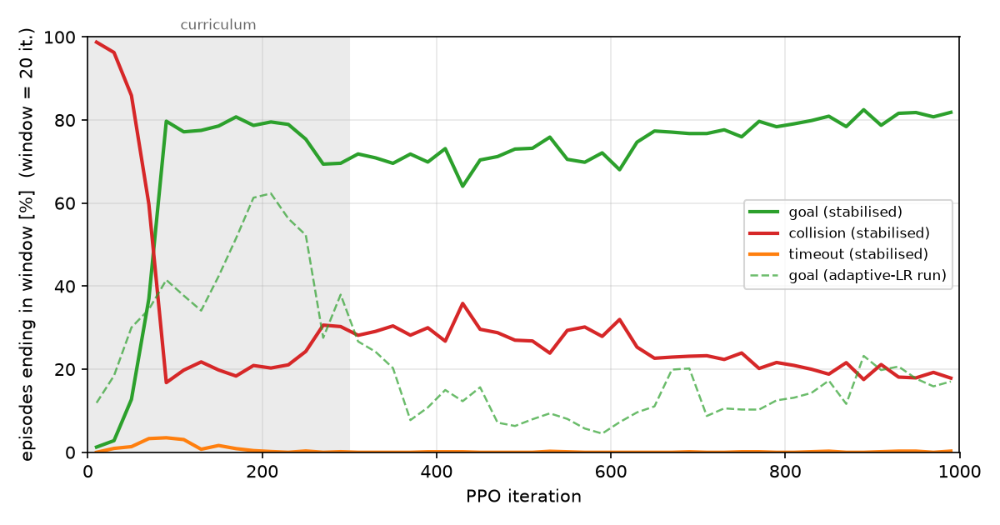
  <br/>
  <em>Share of training episodes ending in goal / collision / timeout per 20-iteration window (stochastic policy).
  Dashed: success rate of the preliminary run. Grey: curriculum phase.</em>
</p>

## 4. Results

### Test performance (unseen layouts)

Final checkpoint (iteration 1,000), deterministic actions (mean of the policy), observation/action noise enabled,
64 environments × first 8 episodes each = 512 episodes on 454 distinct test layouts.

| Metric | Value |
|---|---|
| Success | **85.2 %** (95 % CI 81.8–88.0 %) |
| Collision | 14.6 % |
| Timeout | 0.2 % |
| Time to goal (successes) | 5.4 s |
| Path length (successes) | 2.44 m |
| Mean minimum clearance (all episodes) | 0.39 m |

### Breakdown by layout difficulty

| Obstacles | Episodes | Success | Collision |
|---|---|---|---|
| 3 | 127 | 92.1 % | 7.9 % |
| 4 | 145 | 84.8 % | 15.2 % |
| 5 | 115 | 87.0 % | 12.2 % |
| 6 | 125 | 76.8 % | 23.2 % |

| Start–goal distance | Episodes | Success |
|---|---|---|
| 2.0–2.5 m | 252 | 86.5 % |
| 2.5–3.0 m | 230 | 83.9 % |
| 3.0–4.0 m | 30 | 83.3 % |

Failures are dominated by collisions in dense layouts; the distance to the goal has little effect.

### Training progression (stochastic policy, all training episodes)

| Iterations | Goal | Collision | Timeout | Reference-scene share |
|---|---|---|---|---|
| 1–100 | 21.7 % | 76.7 % | 1.6 % | 86.5 % |
| 101–200 | 78.6 % | 20.1 % | 1.3 % | 49.3 % |
| 201–300 | 74.2 % | 25.6 % | 0.1 % | 17.0 % |
| 301–400 | 70.8 % | 29.2 % | 0.0 % | 0 % |
| 501–600 | 72.3 % | 27.6 % | 0.1 % | 0 % |
| 701–800 | 77.7 % | 22.3 % | 0.1 % | 0 % |
| 901–1000 | 81.0 % | 18.8 % | 0.2 % | 0 % |

The dip after iteration 200 coincides with the transition from the reference scene to fully random layouts;
afterwards performance improves steadily until the end of training.

## 5. Videos

All videos are top-down recordings of complete episodes, from the start pose to the terminal event. GIFs are
sped up (2×, timeouts 6×); click a GIF for the full-resolution MP4 (720 × 720, 40 fps, real time).

### Training (stochastic policy, two randomly selected episodes per outcome)

| Goal | Collision | Timeout |
|---|---|---|
| [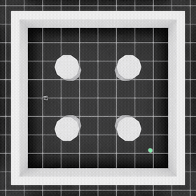](videos/v2/training/goal_2_iter0210.mp4) | [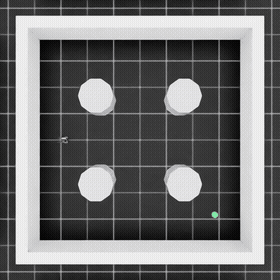](videos/v2/training/collision_1_iter0001.mp4) | [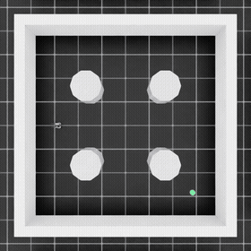](videos/v2/training/timeout_1_iter0035.mp4) |
| iteration 210, reference scene, 337 steps | iteration 1, reference scene, 97 steps | iteration 35, reference scene, 1,199 steps |
| [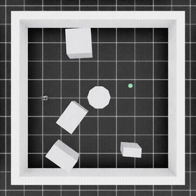](videos/v2/training/goal_3_iter0408.mp4) | [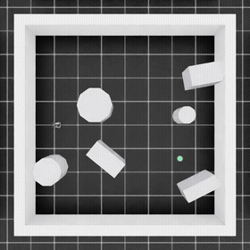](videos/v2/training/collision_4_iter0601.mp4) | [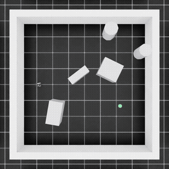](videos/v2/training/timeout_5_iter0825.mp4) |
| iteration 408, random layout, 254 steps | iteration 601, random layout, 51 steps | iteration 825, random layout, 1,199 steps |

All 18 recorded training episodes (6 per outcome, spread over training) are in
[`videos/v2/training/`](videos/v2/training/), with per-episode metadata in `episodes_index.json`.

### Testing (deterministic policy, unseen layouts)

| Episode 1 | Episode 2 | Episode 3 | Episode 4 |
|---|---|---|---|
| [](videos/v2/testing/test_1_goal.mp4) | [](videos/v2/testing/test_2_goal.mp4) | [](videos/v2/testing/test_3_goal.mp4) | [](videos/v2/testing/test_4_goal.mp4) |
| goal, 5.75 s, path 2.50 m (straight line 2.67 m) | goal, 3.30 s, path 1.86 m (2.14 m) | goal, 6.30 s, path 2.68 m (2.92 m) | goal, 5.25 s, path 2.63 m (2.74 m) |

The path can be shorter than the straight start–goal line because an episode succeeds as soon as the robot is
within 0.30 m of the goal.

## 6. Reproducing the results

**Software.** Isaac Sim 4.5.0, Isaac Lab v2.1.1, RL-Games 1.6.1, PyTorch 2.7.0 (CUDA 12.8), Python 3.10.
`scripts/install_isaaclab.sh` performs a user-level installation into a virtual environment (no root access
required).

```bash
# unit tests (pure PyTorch / NumPy, no simulator required)
python -m pytest -q tests

# simulator smoke tests: fixed reference scene and random layouts
python scripts/smoke_test.py --headless
python scripts/smoke_test.py --headless --layout random

# full pipeline on GPU 0: training (+ episode log), filming of training episodes, test evaluation
scripts/run_random_obstacles_v2.sh train
scripts/run_random_obstacles_v2.sh film
scripts/run_random_obstacles_v2.sh test
```

Individual steps:

```bash
# training
python scripts/train.py --headless --layout random --seed 42 --max_iterations 1000 \
    --config configs/ppo_random_obstacles.yaml --proximity exponential --curriculum_iterations 300 \
    --episode_log logs/episodes.csv

# evaluation on the unseen test bank (seed 1000); add --videos 5 to record five complete episodes
python scripts/evaluate.py --headless --checkpoint runs/<experiment>/nn/<checkpoint>.pth \
    --config configs/ppo_random_obstacles.yaml --proximity exponential

# learning-curve figure
python scripts/plot_training.py --log results/episodes_random_obstacles_v2_seed42.csv --label stabilised \
    --curriculum 300 --out docs/media/training_outcomes.png
```

Training is deterministic for a given seed, which is used to record complete training episodes: the first run
logs every episode, `scripts/select_episodes.py` picks episodes per outcome, and an identical second run films
exactly those episodes.

## 7. Repository structure

```
configs/
  ppo_random_obstacles.yaml   PPO configuration used for the results above
  ppo_static_baseline.yaml    adaptive-learning-rate configuration (preliminary runs)
envs/
  nav_env.py                  Isaac Lab DirectRLEnv: layouts, LiDAR, terminations, rewards, resets, logging
  nav_env_cfg.py              environment configuration
  layouts.py                  random layout generation, reachability check, layout banks
  lidar_raycast.py            analytic planar ray casting (walls, cylinders, rotated boxes)
  lidar_processing.py         ray angles, range clipping, sector min-pooling
  observations.py             133-D observation vector
  obstacle_mesh.py            arena wall mesh
rewards/navigation_reward.py  reward terms and termination flags
robots/                       Jetbot articulation and differential-drive kinematics
scripts/                      training, evaluation, video recording, plotting, run scripts
tests/                        unit tests
results/                      episode logs and evaluation results (JSON)
videos/v2/                    training and test videos (MP4)
docs/media/                   figures and GIFs used in this README
```

## 8. Limitations

* **Single seed.** All results come from one training seed; variance across seeds has not been measured.
* **No ablation.** The five stability changes were introduced together (Section 3).
* **Collision model.** Obstacles are kinematic geometry for the LiDAR and visual markers for rendering; they have
  no physics collider. A collision is declared when the closest LiDAR return falls below 0.25 m, before the
  robot body could touch an obstacle.
* **Fixed start.** Only the obstacles and the goal are randomised; the start pose is fixed.
* **Simulation only.** No transfer to a physical robot has been evaluated.
* **Dense layouts.** Collisions rise to 23 % with six obstacles, the main remaining failure mode.
